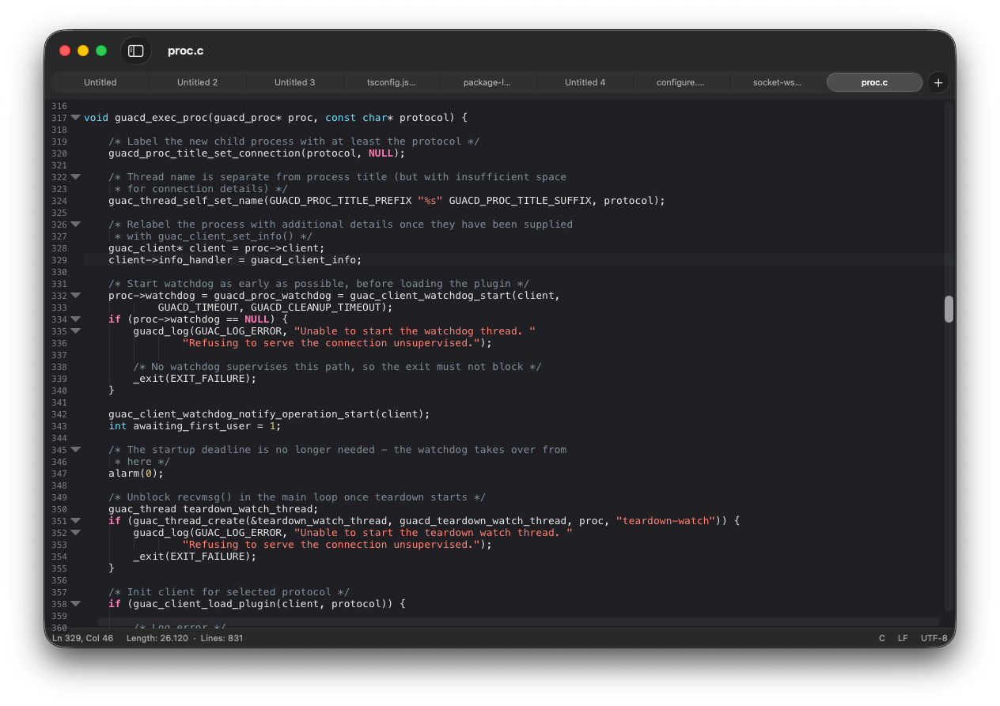

<p align="center">
  
</p>

# macpad-plus-plus

A macOS version of Notepad++: the same editing engine (Scintilla + Lexilla),
wrapped in a native AppKit app that follows the Mac design language.

Website: [macpad-plus-plus.org](https://macpad-plus-plus.org) ·
Downloads: [GitHub Releases](https://github.com/macpad-plus-plus/macpad-plus-plus/releases)

<p align="center">
  
</p>

## Yes, but why?

When I moved to macOS, most of the apps I used on Windows were available, but I couldn't
find a simple alternative to Notepad++. Every app I tried was either too complex or too
simple. And being able to keep countless notes open without ever having to save them,
the feature I missed the most, was practically nonexistent elsewhere.

So I built it (with Claude's help).

## Features

- Scintilla editing engine: multiple carets, column selection (⌥-drag), folding, brace matching
- ~95 languages, with keywords imported from Notepad++'s `langs.model.xml` / `stylers.model.xml`
- Light and dark themes that follow the system appearance and accent colour
- Find bar (⌘F) and Find & Replace (⌥⌘F): match case, whole word, regular expressions
  (`\1` or `$1` in replacements), live match count and highlighting, shared find pasteboard (⌘E)
- Encoding detection (UTF-8, UTF-8 BOM, UTF-16 LE/BE, Windows-1252) and line-ending handling
- Native window tabs, with a toolbar and a sidebar (⌃⌘S):
  - Folder Workspace (⇧⌘O): file tree of one or more folders, live-updated, drag and drop
  - Function List: Notepad++'s function-list parsers (38 languages, plus Swift, Go and Markdown),
    grouped by class, with a filter
- Search menu: Find, Replace, Replace All, Go to Line (⌘L)
- Settings (⌘,): font, tabs/spaces, line numbers, current line, indentation guides, wrapping,
  session, hidden files, defaults for new documents
- Interface in English and Brazilian Portuguese, following the macOS language or chosen in
  Settings; more languages are simple text files anyone can add ([TRANSLATING.md](TRANSLATING.md))
- Themes: Match System, Light, Dark and Classic (Mac OS 9 Platinum: Monaco, lavender highlight,
  platinum bars, Chicago font)
- Session snapshot: quitting never prompts; open tabs, unsaved changes and untitled
  documents come back on the next launch (backed up every 7 seconds)

Session data lives in `~/Library/Application Support/MacPad++/`.

## Requirements

- macOS 14 or later
- Xcode 16 or later
- [XcodeGen](https://github.com/yonaskolb/XcodeGen) (`brew install xcodegen`)

## Building

The Xcode project is generated from `project.yml` and is not checked in.

```sh
xcodegen generate
open MacPad.xcodeproj        # then Run the MacPad scheme
```

Or from the command line:

```sh
xcodebuild -project MacPad.xcodeproj -scheme MacPad -configuration Debug build
```

Run the tests with:

```sh
xcodebuild -project MacPad.xcodeproj -scheme MacPad test
```

If `xcode-select` points at the Command Line Tools, prefix the command with
`DEVELOPER_DIR=/Applications/Xcode.app/Contents/Developer`.

> Keep DerivedData outside iCloud-synced folders (such as `~/Documents`):
> the metadata iCloud adds makes code signing fail.

## Versioning

MacPad++ follows [Semantic Versioning](https://semver.org): `MAJOR.MINOR.PATCH`.
While the version is `0.y.z`, the app is a preview and any release may change behaviour.

- The version lives in one place, `MARKETING_VERSION` in `project.yml`; the About panel
  shows it as "Version 0.1.0".
- `CURRENT_PROJECT_VERSION` is the build number, increased on every distributed build
  (needed by macOS and future auto-updates) and not shown in About.
- Commit messages follow [Conventional Commits](https://www.conventionalcommits.org)
  (`feat:` → minor, `fix:` → patch, `feat!:` or `BREAKING CHANGE:` → major).
- Each release gets a `CHANGELOG.md` entry and a `vX.Y.Z` git tag.

## Releasing

1. Set `MARKETING_VERSION` in `project.yml` and move the `[Unreleased]` notes in
   `CHANGELOG.md` under a new `## [X.Y.Z] - date` heading.
2. Commit, then tag and push: `git tag vX.Y.Z && git push origin vX.Y.Z`.
3. The [Release workflow](.github/workflows/release.yml) builds both DMGs (below) with
   [create-dmg](https://github.com/sindresorhus/create-dmg), swaps in the axolotl background
   from `AppIcon/dmg`, and publishes a GitHub Release
   with the changelog section as notes, plus SHA-256 checksums.

Each release has two DMGs: `apple-silicon` (arm64 only, about a third smaller, for M-series
Macs) and `universal` (arm64 + x86_64, for Intel Macs or anyone unsure). Build them locally
with `scripts/build-dmg.sh apple-silicon` and `scripts/build-dmg.sh universal` (needs Node 20+);
they land in `dist/`.

Without an Apple Developer ID the app is ad-hoc signed, and macOS asks users to approve it
in System Settings ▸ Privacy & Security on first launch. With a Developer ID, add the
secrets listed at the top of the release workflow and releases are signed and notarized.

## Layout

| Path                                       | Contents                                                                                                                                               |
| ------------------------------------------ | ------------------------------------------------------------------------------------------------------------------------------------------------------ |
| `Sources/MacPad/App`                       | Entry point, app delegate, main menu, session store, document controller                                                                               |
| `Sources/MacPad/Document`                  | `NSDocument` subclass, encoding and line-ending handling                                                                                               |
| `Sources/MacPad/Editor`                    | `ScintillaEditor` (Swift wrapper around `ScintillaView`), search, language catalog, themes                                                             |
| `Sources/MacPad/Window`                    | Window controller (native tabs), editor view controller, find bar, status bar                                                                          |
| `Sources/MacPad/Resources/NotepadPlusPlus` | Language definitions from Notepad++                                                                                                                    |
| `Sources/MacPad/Window/Sidebar`            | Sidebar: folder workspace and function list                                                                                                            |
| `Sources/MacPad/Resources/FunctionList`    | Function-list parsers from Notepad++ (plus Swift, Go, Markdown)                                                                                        |
| `Sources/MacPad/Resources/Localization`    | Interface translations, one `<language>.lproj/Localizable.strings` per language                                                                        |
| `scripts/update-translations.py`           | Regenerates the English template and syncs every translation                                                                                           |
| `Sources/MacPad/Resources/Fonts`           | ChicagoFLF (public domain), for the Classic theme                                                                                                      |
| `scripts/build-dmg.sh`                     | Release build and DMG packaging                                                                                                                        |
| `scripts/render-dmg-background.swift`      | Draws the DMG window background with the axolotl (`AppIcon/dmg`)                                                                                       |
| `.github/workflows`                        | CI (build and test) and Release (DMG on version tags)                                                                                                  |
| `AppIcon`                                  | Icon source art (SVG master, small-size variant, .icns, PNGs, favicon); `AppIcon.appiconset` is copied into `Sources/MacPad/Resources/Assets.xcassets` |
| `AppIcon/axolote`                          | The axolotl mascot (with and without "++"), SVG and PNG; the "sem-plus" version appears in the sidebar's empty states                                  |
| `docs/images`                              | Screenshots used in this README |
| `Tests/MacPadTests`                        | Unit tests                                                                                                                                             |
| `Sources/ScintillaModule`                  | Module map that exposes Scintilla and Lexilla to Swift                                                                                                 |
| `Vendor/scintilla`, `Vendor/lexilla`       | Upstream sources (Scintilla 5.6.6, Lexilla 5.5.3) with the patches in `Vendor/PATCHES.md` |

## License

GPL v3, like Notepad++, from which the language definitions and function-list
parsers are taken.
Scintilla and Lexilla are under their own permissive license (see
`Vendor/*/License.txt`). Details in [LICENSE](LICENSE).
